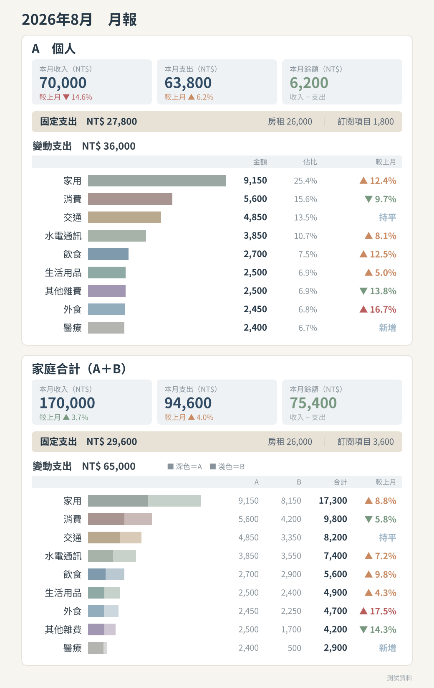
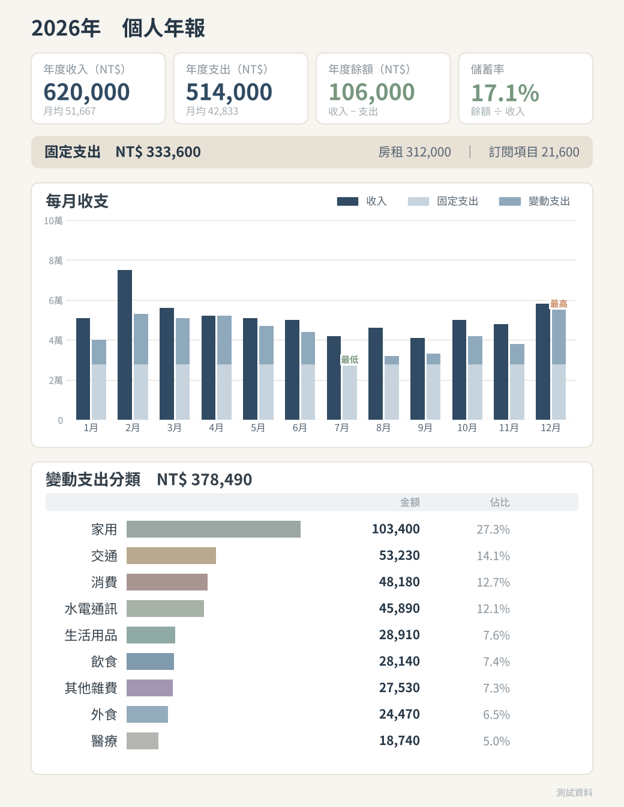
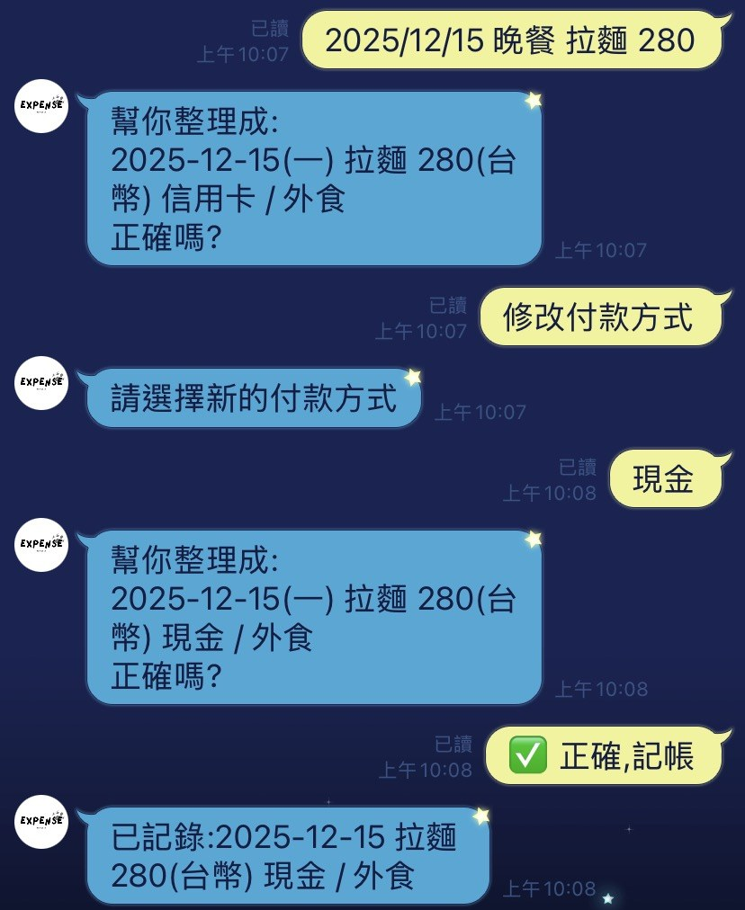
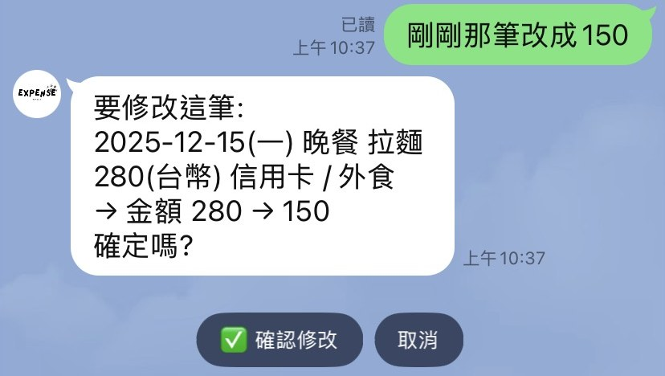
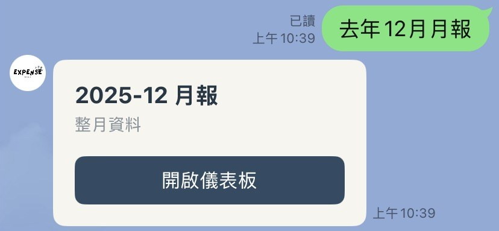
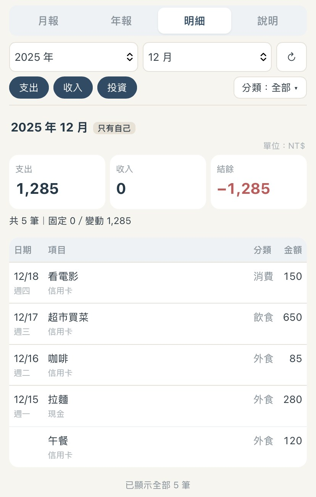

# LINE Expense Tracking Bot

**English** | [中文](README_zh.md)

An expense tracker that lives inside LINE (input is currently in Chinese; examples below are shown with English translations): record, query and edit expenses with a single sentence. It supports multiple users and family totals, 26 currencies and a travel mode, pushes monthly and annual reports automatically, and includes a web dashboard that opens inside LINE.

I built this for myself and my family to replace our Google Sheets expense log. It was developed with [Claude Code](https://claude.com/claude-code) as a coding partner: I decided the requirements, category rules, permission design and trade-offs, and tested and accepted every feature on my phone; the AI helped write the code and tests.

| Monthly report push (test data) | Annual report push (test data) |
|---|---|
|  |  |

| Record in one sentence: saved only after confirmation | Edit in one sentence: shows before and after |
|---|---|
|  |  |
| **Open a report in one sentence** | **Dashboard details page** |
|  |  |

## Features

- **Record in one sentence**: `昨天跟朋友吃拉麵 1200 日圓` ("Ramen with friends yesterday, 1200 yen") → the LLM extracts the date, item, amount and currency, and pre-fills the category and payment method from the user's own history. A confirmation screen lets the user edit any field; nothing is saved until they confirm.
- **Query in one sentence**: `上個月外食花多少` ("How much did I spend eating out last month?"), `今年花最多的三個分類` ("My top three categories this year"), `這個月比上個月多花多少` ("How much more did I spend this month than last month?"), `在日本花了多少` ("How much did I spend in Japan?") → returns a summary, ranking, comparison or itemized list.
- **Edit in one sentence**: `剛剛那筆改成 150` ("Change that last one to 150"), `刪掉昨天的咖啡` ("Delete yesterday's coffee") → shows the record before and after, and saves only after confirmation.
- **Automated reports**: a monthly report on the 5th of each month and an annual report each January (text + matplotlib charts), one for each person and one for the family total.
- **Web dashboard**: a LINE LIFF page for any month or year, with charts drawn in Chart.js.
- **Details page**: every transaction in one place, filterable by period, income or expense, and category. Totals use the same rules as the reports. Tapping a category in a monthly or annual report opens its details directly, and the list loads the next page automatically on scroll.
- **Multi-currency and travel mode**: `旅遊 巴黎` ("Travel Paris") switches the time zone and default currency in one step. Each person's reports are calculated in their own home currency; other currencies are listed separately with an exchange-rate reference value.
- **Admin-approved sign-up**: new users need admin approval after adding the bot as a friend; access can be suspended and restored.

## Design Highlights

**The LLM only *understands*; it never *executes***
The LLM only outputs a structured query plan (period, category, scope, currency). Code validates the plan before querying the database; the LLM never writes SQL. Query scope (the user only, or their family members) is decided by the backend from the user's identity, never taken from the LLM's output. Every write requires the user to confirm, and on confirmation the record is re-read to check its owner and deletion status again.

**All amounts are calculated in code**
Category rules (income, investment, fixed, variable) live in one place and are shared by the pushed reports, the dashboard and natural-language queries. The reply to the `本月` ("This month") command and to the question "How much did I spend this month?" come from the same code, and tests ensure the two are identical.

**Multiple currencies and exchange rates**
Each person's reports are calculated in their own home currency. For closed periods, exchange rates are frozen in `fx_snapshots`; open periods use live rates. Reference values for past months therefore don't change each time they are viewed.

**Security and privacy**
- Every dashboard API call verifies the LIFF access token and checks that the token was issued for this service's channel.
- Cron routes are protected by a secret, compared in constant time.
- Report images are stored in a private bucket and pushed using signed URLs.
- Deletion is soft deletion; keys live only in environment variables.

**Testability**
Parsing, dates and time zones, currencies, aggregation, report text and permission scope are all pure functions that don't depend on LINE or the database. Flow tests use fake database, LINE and LLM clients. 25 test files with more than 1,200 checks run automatically on every push via GitHub Actions.

## Architecture

```
LINE Messaging API ──▶ Flask webhook (Render, gunicorn)
                         ├─ Commands / one-sentence record, query, edit
                         │     └─ LLM (Gemini, switchable to Claude) → structured output → validated in code
                         ├─ /cron/monthly, /cron/annual ◀── cron-job.org
                         │     └─ Aggregate → matplotlib charts → Supabase Storage (private) → LINE push
                         └─ /dashboard, /api/* ◀── LIFF web dashboard (Chart.js)
                                   │
                         Supabase (Postgres) + exchange-rate API (open.er-api.com)
```

**Tech stack**: Python 3.13, Flask, gunicorn, LINE Messaging API / LIFF, Supabase (Postgres, Storage), Gemini / Claude API, matplotlib, Chart.js, GitHub Actions, Render

## Roadmap

- **Trip reports**: define a trip by date range and currency to see how much the whole trip cost and which categories it went to; works for domestic trips too.
- **Details page v2**: CSV export, editing and deleting records directly on the web page, and more filters (payment method, currency, item keywords).
- **Year-over-year comparison in annual reports**: once a full year of data exists, compare each category with the same period last year.

## Source Code

The source code for this project is not public; this repository only presents the project overview and screenshots. If you'd like to review the code or see a live demo, feel free to contact me through GitHub.

© 2026 Kai-Wen Huang. All rights reserved.
