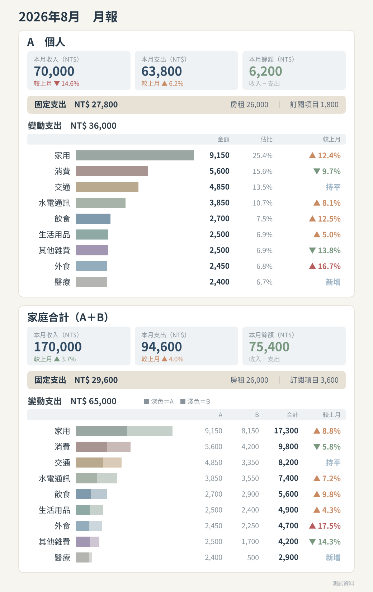
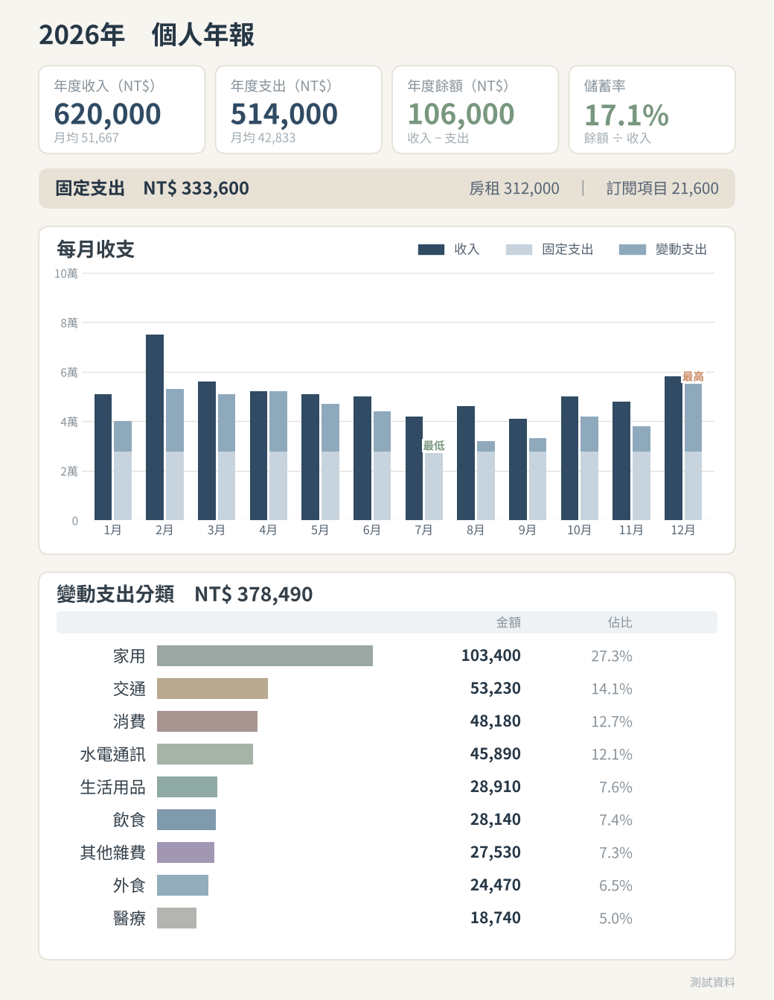
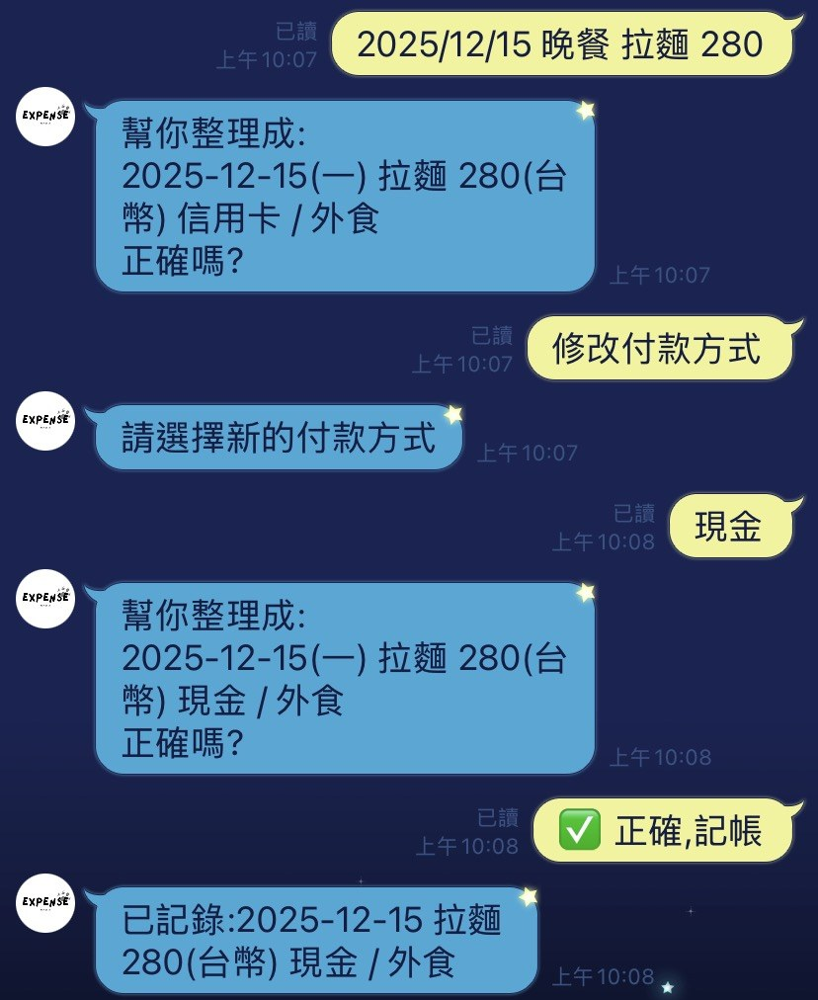
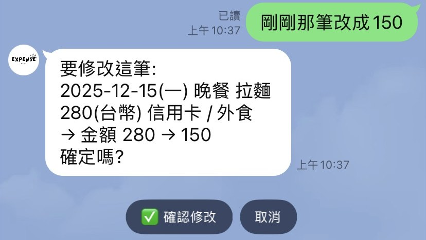
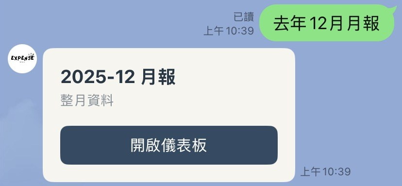
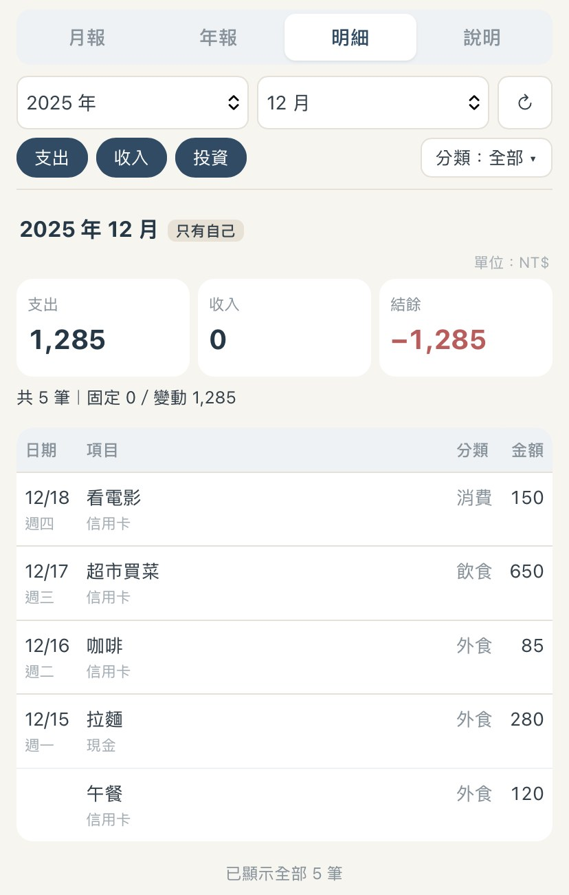

# LINE 記帳機器人

   [English](README.md) | **中文**
在 LINE 裡直接用一句話記帳、查帳、改帳的記帳系統。支援多人與家庭合計、26 種幣別與旅遊模式，每月自動推播月報與年報，並提供在 LINE 內開啟的網頁儀表板。

這是我為自己和家人做的系統，用來取代原本的 Google Sheet 記帳表。開發過程使用 [Claude Code](https://claude.com/claude-code) 協助：需求、分類規則、權限設計與取捨由我決定，並在手機上實測驗收；程式撰寫與測試由 AI 協助完成。

| 月報推播（測試資料） | 年報推播（測試資料） |
|---|---|
|  |  |

| 一句話記帳：確認後才寫入 | 一句話改帳：顯示修改前後 |
|---|---|
|  |  |
| **一句話開報表** | **儀表板明細頁** |
|  |  |

## 可以做什麼

- **一句話記帳**：`昨天跟朋友吃拉麵 1200 日圓` → LLM 解析出日期、項目、金額、幣別，並依個人歷史習慣預填分類與付款方式；進確認畫面，可逐欄修改，按下確認才寫入。
- **一句話查帳**：`上個月外食花多少`、`今年花最多的三個分類`、`這個月比上個月多花多少`、`在日本花了多少`，回覆總覽、排行、比較或明細。
- **一句話改帳**：`剛剛那筆改成 150`、`刪掉昨天的咖啡`，顯示修改前後，確認後才寫入。
- **自動報表**：每月 5 號推播月報、每年 1 月推播年報（文字 ＋ matplotlib 圖表），個人與家庭合計各一份。
- **網頁儀表板**：LINE LIFF 頁面，可查任一月份或年度，Chart.js 畫圖。
- **明細頁**：在儀表板查看自己的每一筆收支，可依期間、收支類型、分類篩選，合計與報表用同一套規則計算；在月報、年報點某個分類可直接打開那個分類的明細，捲到底自動載入下一頁。
- **多幣別與旅遊模式**：`旅遊 巴黎` 一次切換時區與預設幣別；報表依各人的主幣別計算，其他幣別另列並附匯率換算參考值。
- **管理員核准制註冊**：加好友後要管理員核准才能使用，可以停權、恢復。

## 設計重點

**LLM 只負責「理解」，不負責「執行」**
LLM 只輸出結構化的查詢計畫（期間、分類、範圍、幣別），由程式驗證後才查資料庫，不讓 LLM 寫 SQL。查詢範圍（本人／同家庭成員）由後端依身分決定，不採信 LLM 的輸出。所有寫入都要使用者按確認，按下時會重新讀取記錄，再檢查一次擁有者與刪除狀態。

**金額計算全部由程式完成**
分類規則（收入、投資、固定、變動）集中在一處，推播報表、儀表板、自然語言查詢共用。`本月` 指令和問「這個月花多少」的回覆由同一段程式產生，有測試確保兩者完全相同。

**多幣別與匯率**
每個人的報表用自己的主幣別計算。已結束的期間把匯率固定存進 `fx_snapshots`，進行中的期間用即時匯率，所以過去月份的參考值不會每次查看都不一樣。

**資安與隱私**
- 儀表板 API 每次都驗證 LIFF access token，並確認 token 是發給本服務的 channel。
- cron 路由用密鑰保護，以常數時間比對。
- 報表圖片放在 Private bucket，推播使用 signed URL。
- 刪除是軟刪除，金鑰只放環境變數。

**可測試性**
解析、日期與時區、幣別、彙總、報表文字、權限範圍都寫成不依賴 LINE 和資料庫的純函式；流程測試用假的資料庫、LINE、LLM。共 25 支測試、超過 1,200 項檢查，每次 push 都由 GitHub Actions 自動執行。

## 系統架構

```
LINE Messaging API ──▶ Flask webhook（Render, gunicorn）
                         ├─ 一般指令／一句話記帳、查詢、修改
                         │     └─ LLM（Gemini，可切換 Claude）→ 結構化結果 → 程式驗證
                         ├─ /cron/monthly、/cron/annual ◀── cron-job.org
                         │     └─ 彙總 → matplotlib 畫圖 → Supabase Storage（Private）→ LINE 推播
                         └─ /dashboard、/api/* ◀── LIFF 網頁儀表板（Chart.js）
                                   │
                         Supabase（Postgres）＋ 匯率 API（open.er-api.com）
```

**技術棧**：Python 3.13、Flask、gunicorn、LINE Messaging API／LIFF、Supabase（Postgres、Storage）、Gemini／Claude API、matplotlib、Chart.js、GitHub Actions、Render

## 之後想做

- **旅行報表**：用日期區間加幣別圈出一趟旅程，看整趟旅行花了多少、花在哪些分類；國內旅遊也適用。
- **明細頁第二版**：匯出 CSV、直接在網頁上修改或刪除記錄、增加付款方式、幣別和項目關鍵字篩選。
- **年報「較去年」比較**：累積滿一年資料後，年報加入各項目和去年同期的比較。

## 程式碼

本專案的程式碼不公開，這個 repo 只用來展示專案介紹與截圖。如需檢視程式碼或想看實際操作，歡迎透過 GitHub 與我聯絡。

© 2026 Kai-Wen Huang，保留所有權利。
